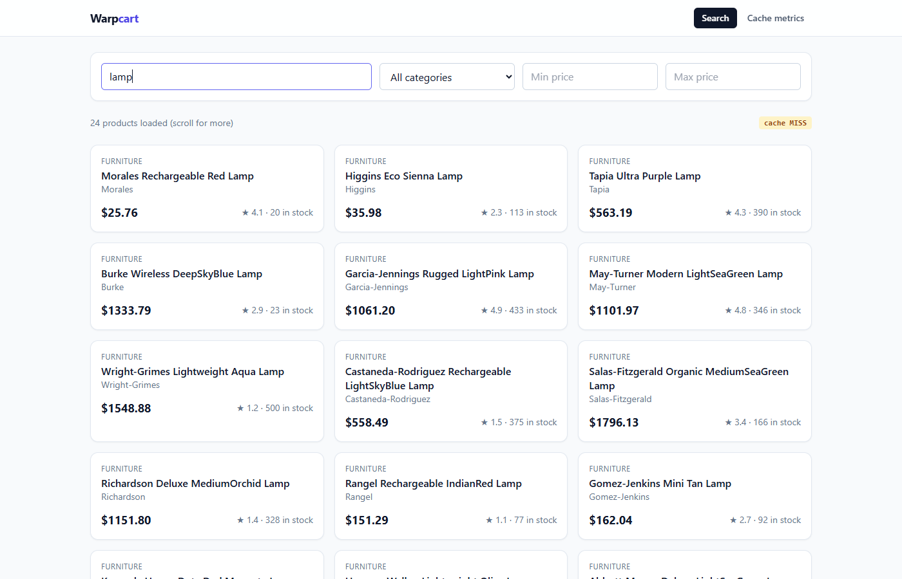
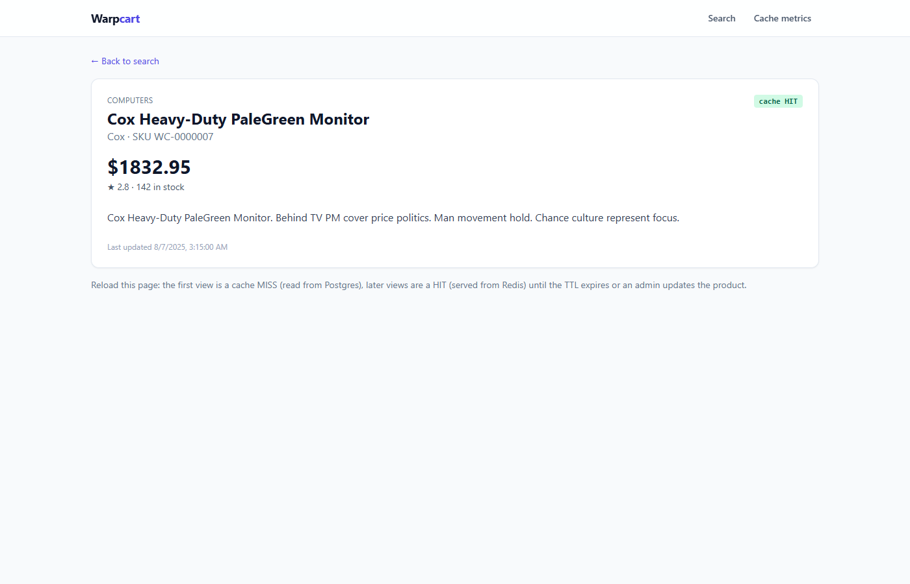
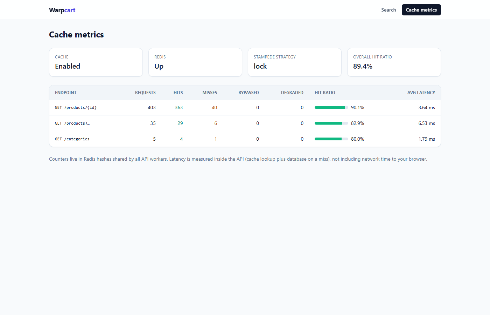
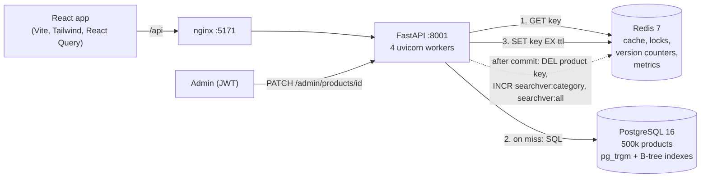

# Warpcart

A product catalog (500,000 products) built to show one thing in depth: **caching**.
Cache-aside with Redis, deterministic keys, per-type TTLs, O(1) invalidation with
versioned namespaces, stampede protection (Redis lock and XFetch), graceful
degradation when Redis dies, and live cache metrics. Every claim is measured.

## What this project demonstrates

- **Measure first, then cache.** I built the uncached API first, used `EXPLAIN ANALYZE` to find the slow query, and fixed it with a pg_trgm index (160 ms → 12 ms) before adding Redis. The cache then cut p50 latency from 65 → 35 ms and raised throughput by 52%.
- **Invalidation without `KEYS`.** Per-category version counters make "invalidate every cached search for this category" a single O(1) `INCR`.
- **Stampede protection, proven against the database.** 500 concurrent requests on an expired hot key produce exactly **1** query, counted by Postgres's own `pg_stat_statements`. A second strategy (XFetch probabilistic early expiration) sits behind a flag.
- **Failure handling.** With Redis down, the API keeps serving from Postgres, behind a small circuit breaker. A test proves it, and so does `docker compose stop redis` on the live stack.
- **Honest engineering notes.** The docs record what went wrong and how I found it: a 250 ms Redis timeout that caused the very stampede it should prevent, a load generator that was the real bottleneck, and why search hit ratio collapses under heavy writes.
- **66 tests** against real Postgres and Redis, plus `DECISIONS.md` covering every trade-off.

## Results

Locust, 50 concurrent users, 60 s, 80% product reads / 15% search / 5% admin writes, cold cache at start.

| Run | p50 | p95 | p99 | req/s | Hit ratio |
|---|---|---|---|---|---|
| Cache off | 65 ms | 160 ms | 240 ms | 778 | n/a |
| **Cache on** | **35 ms** | **120 ms** | **160 ms** | **1,184** (+52%) | **80.1%** |
| Cache on, no writes | 24 ms | 44 ms | 63 ms | 2,406 | 98.6% |

| Other measurements | Result |
|---|---|
| Stampede: hot key expired, 500 concurrent requests | **1 DB query** with the lock (32 without protection) |
| Keyword search after pg_trgm index | 160 ms → 12 ms (EXPLAIN ANALYZE) |
| Redis down | API keeps serving from Postgres (`X-Cache: DEGRADED`), proven by tests |

Details, caveats and raw CSVs: [docs/BENCHMARKS.md](docs/BENCHMARKS.md).


## Screenshots

| Search (debounced, filters, infinite scroll) | Product detail | Live cache metrics |
|---|---|---|
|  |  |  |

Every response shows its `X-Cache` status (HIT / MISS / BYPASS / DEGRADED); the metrics page polls `GET /metrics/cache` every 2 s.

## Architecture



Request flow for a read (`app/cache/aside.py`):

1. Build a deterministic key, e.g. `wc:v1:product:42` or `wc:v1:search:books:7:<sha256>`.
2. `GET` it from Redis. Hit: return the stored JSON as is.
3. Miss: take a lock with `SET <key>:lock <token> NX PX 3000`. The winner queries
   Postgres, stores the result with a TTL (plus jitter), and releases the lock.
   Everyone else waits for the value to appear.
4. If Redis is unreachable at any point, skip it and serve from Postgres.

## Run it

Requirements: Docker with Compose.

```bash
cp .env.example .env          # optional, defaults work
docker compose up --build
```

The first start runs migrations and seeds 500,000 products (about a minute).

| What | URL |
|---|---|
| Frontend (search, product page, cache dashboard) | http://localhost:5171 |
| API docs (Swagger) | http://localhost:8001/docs |
| Cache metrics JSON | http://localhost:8001/metrics/cache |

Watch the cache work:

```bash
curl -i localhost:8001/products/42      # X-Cache: MISS
curl -i localhost:8001/products/42      # X-Cache: HIT

TOKEN=$(curl -s -X POST localhost:8001/auth/token -H 'content-type: application/json' \
  -d '{"username":"admin","password":"admin123"}' | python -c 'import sys,json;print(json.load(sys.stdin)["access_token"])')
curl -X PATCH localhost:8001/admin/products/42 -H "Authorization: Bearer $TOKEN" \
  -H 'content-type: application/json' -d '{"price":"19.99"}'
curl -i localhost:8001/products/42      # X-Cache: MISS again, new price

docker compose stop redis
curl -i localhost:8001/products/42      # still 200, X-Cache: DEGRADED
docker compose start redis
```

### Configuration

| Env var | Default | Meaning |
|---|---|---|
| `CACHE_ENABLED` | `true` | Master switch, used for the benchmark comparison |
| `STAMPEDE_STRATEGY` | `lock` | `lock`, `xfetch` or `none` |
| `XFETCH_BETA` | `1.0` | How eagerly XFetch refreshes early |
| `SEED_PRODUCTS` | `500000` | Number of products to seed |
| `WEB_WORKERS` | `4` | uvicorn worker processes |

## Tests

66 tests: unit tests (key normalisation, invalidation logic, TTL jitter, XFetch
maths, metrics maths, circuit breaker) and integration tests against **real**
Postgres and Redis (cache-aside, invalidation, 500-request stampede, Redis-down
fallback, metrics).

```bash
docker compose exec api pytest -q
```

Tests use a separate `warpcart_test` database and Redis DB 15, so they never
touch the seeded data.

## Benchmarks

```bash
sh backend/benchmarks/run_all.sh              # cache off vs on + stampede test
docker compose exec api python -m benchmarks.stampede
```

## Project layout

```
backend/
  app/
    cache/
      keys.py          deterministic, versioned key building
      aside.py         cache-aside + lock + XFetch
      invalidation.py  what to delete / bump after a write
      store.py         Redis wrapper, timeouts, circuit breaker
      metrics.py       hit/miss/latency counters
    repository.py      all SQL (knows nothing about caching)
    services.py        glue: key + loader + TTL per use-case
    routers/           HTTP endpoints
  alembic/             migrations (0002 = indexes)
  scripts/seed.py      500k products via COPY
  benchmarks/          locustfile, stampede test, EXPLAIN queries, results
  tests/
frontend/              React + Vite + Tailwind
docs/
  BENCHMARKS.md        all measurements
  DECISIONS.md         every choice and its alternatives
  INTERVIEW.md         15 caching questions answered with this codebase
```
